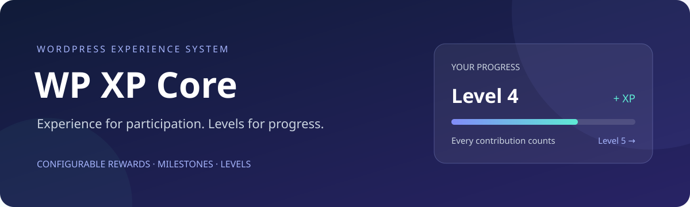

<!-- wp-xp-core-version: 2.2.0-rc.1 -->

  
  
  
  
  

<strong>为站点参与积累经验，用可配置的等级呈现成长。</strong>

简体中文 · <a href="README.en.md">English</a>

<a href="#开始使用">开始使用</a> · <a href="docs/GUIDE.md">使用指南</a> · <a href="docs/CONFIGURATION.md">服务器配置</a> · <a href="CHANGELOG.md">更新记录</a>

## 你能用它做什么

- **奖励日常参与。** 每日签到、有效阅读、发表文章与合格评论都可获得经验，各活动奖励由管理员设置。
- **鼓励作者创作。** 为文章增删浏览里程碑；接入 PageNest Companion 后，还可配置点赞里程碑。
- **设计自己的成长曲线。** 用可增删列表设置 1–100 级的最低经验，无需改代码。
- **让用户看见进度。** 经验面板展示当前经验、等级、距离下一级的经验、签到按钮与近期私人记录。
- **保留奖励依据。** 以事件账本记录经验变化，重复请求不会重复领取同一奖励。
- **接入可选活动。** 在后台选择可信来源，设置奖励、每日次数、分数门槛和私人消息；缺少配套插件时，基础经验系统仍可独立运行。

经验与等级由插件独立维护，无需 myCRED。点赞服务是可选集成；不可用时，后台会禁用点赞规则，其余设置仍可编辑。

## 开始使用

本分支文档对应 **2.2.0-rc.1**。下载安装包时，请以 [Release](https://github.com/wzf2000/wp-xp-core/releases) 中实际发布的版本为准。

更新已有站点前请备份，并先在隔离环境验证；不同版本的功能以对应 Release 标签内的文档为准。新站上传安装包并启用后，插件会建立经验账本并使用默认规则，无需配置服务器 JSON，也无需安装其他经验插件。既有用户从 0 经验开始，不会根据旧文章或历史评论自动补发奖励。

1. 从 [Release](https://github.com/wzf2000/wp-xp-core/releases) 下载 `wp-xp-core-版本号.zip`，不要使用 GitHub 自动生成的 **Source code** 压缩包。首次安装自动配置需要 **1.4.0 或更高版本**；旧版安装要求以其发行文档为准。
2. 在 WordPress **插件 → 安装插件 → 上传插件** 中安装 ZIP 并启用。
3. 打开 **设置 → WP XP Core**，查看或修改奖励与等级规则；默认值可直接使用。
4. 新建一个名为 “我的经验” 的普通页面，添加 **短代码** 区块，填入 `[reader_experience]`，然后发布。详细步骤见[创建经验页面](docs/GUIDE.md#创建经验页面)。
5. 回到插件设置，在 **添加经验面板** 中选择刚发布的页面，点击 **保存面板页面**。用户登录后便可在该页查看经验、签到和最近记录。

“我的经验” 是普通 WordPress 页面，不要求站点已有账户系统。经验内容按当前登录用户展示；插件启用时不会自动创建或发布页面。

已安装的站点可用新 Release ZIP 更新。停用／重新启用会保留经验与设置；可选官方 GitHub 更新检查默认关闭，可在配置工具显式启用。服务器外部配置属于可选的[高级接入](docs/CONFIGURATION.md)，普通首次安装无需阅读或准备旧插件迁移。

## 配置你的经验规则

设置页将规则分为 **日常活动、作者里程碑、等级成长**。可设置活动开关、适用内容、阅读停留时间、奖励与每日次数，增删里程碑和等级。每日统计时区只能在账本没有事件时修改。

| 活动                   | 默认规则                                                  |
| ---------------------- | --------------------------------------------------------- |
| 每日签到               | +2，每日一次                                              |
| 有效阅读               | 停留至少 15 秒，+1，每日最多奖励 3 次                     |
| 首次发表文章           | 每篇 +20                                                  |
| 合格评论               | 每条 +2，每日最多奖励 3 次                                |
| 作者浏览里程碑         | 100／500／1000 次，分别 +5／10／20                        |
| 作者点赞里程碑（可选） | 10／30／100 次，分别 +5／10／20                           |
| 等级成长               | 默认 10 级：0、5、20、60、150、300、600、1000、1800、3000 |

**奖励变更用于之后首次记账的事件；等级门槛变更会即时影响等级展示。** 修改门槛不会改动余额，保存设置也不会补发奖励。每篇文章每档里程碑只领取一次；降低次数后，尚未领取的档位可能在下一次有效活动时达标。

取值范围、评论资格、计数方式及示例见[规则设置指南](docs/GUIDE.md#设置经验规则)。

## 管理与成长

后台从 **设置 → WP XP Core** 统一进入；经验规则、事件账本、运行诊断、成长中心、任务与成就、激励效果、活动与通知和配置工具通过页面内页签切换。

- **事件账本与诊断：** 按用户、来源和日期查询记录；带原因增减个人经验，撤销人工调整；只读核对账本与余额，并处理已明确记录的失败奖励。
- **成长中心：** 设置等级名称、图标字符、颜色和说明；个人页面显示签到日历、连续／累计签到、进度和私人历史。额外签到阶段奖励默认关闭，启用后只累计新签到。
- **任务与成就：** 创建一次性、每日、每周或每月任务；自动任务可组合内置活动与已注册可信来源步骤，审核任务由用户提交说明。成就默认只授予荣誉，可配置完成经验与图片徽章；支持具原因的人工授予／撤销，已获得成就保留当时快照。
- **先预览，再运营：** 保存前查看任务条件与版本影响，复制任务生成默认停用的新草稿；管理员可带原因短期暂停个人自动奖励，在运行诊断中手动采样查询表现、解释已有回执，或只读模拟一条假设活动的奖励。
- **控制活动奖励与公开参与：** 可选日／周活动经验上限默认关闭，个人可退出榜单，管理员可排除测试账号并查看活动线索与等长期间趋势。
- **可组合的私人成长组件：** 用五个独立短代码或区块展示本人概览、任务、成就、通知或成长路径；可设置条数、密度、标题与强调色，操作继续在完整面板完成。
- **私人通知与下一步目标：** 在个人面板查看成就、审核与升级通知，管理已读和类型偏好；任务显示剩余目标、可用内容链接与前置条件。
- **周榜、月榜与激励效果：** 手动放置 `[xp_leaderboard period="week" limit="10"]` 或月榜短代码，按本期活动净经验展示排名；个人面板可查看本人位置，管理员可查看来源分析、具体扩展的有效零经验原因、关联任务完成率及受保护的汇总 CSV。周月切换不重置经验余额。

具体操作和修改后的影响见[使用指南](docs/GUIDE.md)。这些功能不扫描全站历史补发经验，不创建定时任务，也不提供商城或可消费货币。

## 接入其他活动与通知

打开 **设置 → WP XP Core → 活动与通知**，选择已识别来源，预览并保存奖励和消息。新来源默认关闭，启用或改变奖励资格后只处理新活动，不补历史。日常调整无需编辑代码。

| 可选接入       | 你可以做什么                                                   | 未安装配套时                             |
| -------------- | -------------------------------------------------------------- | ---------------------------------------- |
| bbPress        | 为符合公开资格的新主题、回复配置经验                           | 来源不可用；已有配置保留                 |
| 服务端验证游戏 | 设置固定经验、每日次数和最低分；需要支持公共结算接口的游戏扩展 | 不影响签到、阅读等基础奖励               |
| Companion 通知 | 在经验面板读取本人已有通知，沿用原来源的已读状态               | 仍可使用独立经验通知                     |
| 扩展通知渠道   | 选择已注册渠道处理活动消息                                     | 不主动外发消息；本版不内置邮件或 Webhook |

游戏成绩由游戏扩展核验和保存，经验由本插件独立记账；纯浏览器游戏不会自动变为可信奖励来源。自研插件需由扩展作者[一次接入公开接口](docs/CONFIGURATION.md#可信活动提供者)，接入后由管理员维护数值与文案。已注册通知渠道的明确失败消息可由管理员带原因手动重试；成功或结果未知的投递不能重投，不重新发放经验。操作步骤和限制见[活动与通知指南](docs/GUIDE.md#从后台设置可选活动与通知)。

## 运行要求

WordPress 6.0、PHP 8.0 或更高版本；实际 CI 组合见[贡献指南](CONTRIBUTING.md)。数据库须支持 InnoDB 事务，以及 `JSON_VALID`、`JSON_EXTRACT`、`JSON_UNQUOTE`、`JSON_TYPE`。激活会在写入前检查这些能力，不支持时明确提示并保留原存储。

## 文档与帮助

| 你想做什么                         | 阅读入口                            |
| ---------------------------------- | ----------------------------------- |
| 设置奖励、添加等级、放置经验面板   | [使用指南](docs/GUIDE.md)           |
| 排查维护提示、未获得经验、点赞禁用 | [常见问题](docs/GUIDE.md#常见问题)  |
| 接入服务器配置、存储或其他插件     | [配置与集成](docs/CONFIGURATION.md) |
| 查看版本变化                       | [更新记录](CHANGELOG.md)            |
| 参与开发或提交改进                 | [贡献指南](CONTRIBUTING.md)         |
| 维护 GitHub 发行                   | [发布流程](docs/RELEASING.md)       |

本分支文档对应 2.2.0-rc.1。使用其他版本时，请以对应 Release 标签内的文档为准。

遇到问题可[提交 Issue](https://github.com/wzf2000/wp-xp-core/issues/new/choose)，附上版本、现象与复现步骤。安全问题请按[安全政策](SECURITY.md)私下报告。

## 作者与许可

由 [wzf2000](https://github.com/wzf2000) 维护，采用 **[GPL-2.0-or-later](LICENSE)**。欢迎通过 Issue 和 Pull Request 参与改进。
